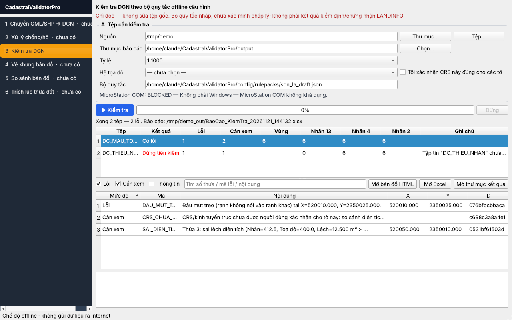
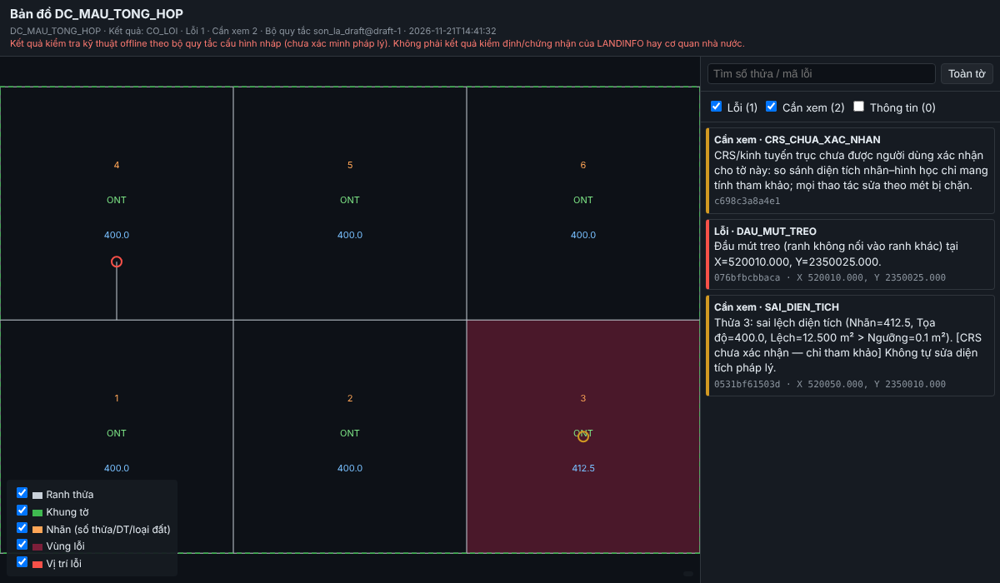

# CadastralValidatorPro

Phần mềm Windows (ưu tiên offline, giao diện tiếng Việt) hỗ trợ cán bộ kỹ thuật địa chính kiểm tra, chuẩn hóa và biên tập dữ liệu bản đồ địa chính (DGN/GML/SHP). Xây dựng theo **Master Prompt V2.2 — Sơn La**, tham khảo quy trình phần mềm "GML2DGN 1.2" trong video [Ứng dụng Chuẩn hóa bản đồ](https://www.youtube.com/watch?v=ZG7MRxzzLTM).

> ⚠️ Kết quả là **kiểm tra kỹ thuật offline theo bộ quy tắc cấu hình nháp**, chưa xác minh pháp lý. Không phải kết quả kiểm định/chứng nhận của LANDINFO hay cơ quan nhà nước. Phần mềm **không sửa tệp gốc**.

## Trạng thái các Gate (21/11/2026)

| Gate | Nội dung | Trạng thái |
|---|---|---|
| G0 | Khảo sát môi trường, dữ liệu, API, rủi ro | **PARTIAL** — xong phần làm được không cần Windows; MicroStation COM chưa khảo sát trên máy thật |
| G1 | GUI 6 tab; Tab 3 kiểm tra DGN | **PARTIAL** — lõi kiểm tra + báo cáo + GUI chạy, 49 test PASS trên **dữ liệu tổng hợp**; đọc DGN V8 thật cần MicroStation (NOT TESTED) |
| G2–G7 | Tab 1, 2, 4, 5, 6; đóng gói EXE | Chưa triển khai |

**Chưa nghiệm thu tương thích dữ liệu thật.** Lý do: cả 5 tệp DC*.dgn và seed1000.dgn là DGN V8 (OLE + zlib, định dạng phần tử độc quyền) — xem [`docs/gate0/api_probe_report.md`](docs/gate0/api_probe_report.md).

## Tab 3 làm được gì (G1)

- **Tầng A — tiền kiểm:** đếm nhãn Level 2 (loại đất), 4 (diện tích), 13 (số thửa) kể cả trong TextNode và Cell `NHANTHUA`; thiếu nhóm nào thì dừng tờ đó với thông báo chuẩn. Đề xuất chuyển Level cho nhãn ở Level 11/12/14/15/16 (chỉ xem trước).
- **Tầng B — topology/thuộc tính:** dựng vùng từ nét Level 10/22/23/31/32 (+ khung 54) bằng noding + polygonize, snap trên bản sao trong bộ nhớ; đầu mút treo; vùng không nhãn; mảnh vụn; trùng nhãn; nhãn ngoài vùng; nhãn sát ranh (AMBIGUOUS); trùng số thửa; sai lệch diện tích nhãn–hình học; quy cách làm tròn; mã loại đất (kể cả mã ghép `ONT+CLN`); thửa nhỏ; thửa ngoài khung; overlap/gap cho dữ liệu polygon (gap chỉ khi có vùng bao phủ); cảnh báo CRS chưa xác nhận và nghi đảo trục X–Y.
- **Tầng C — kết quả:** bảng theo tờ, bảng lỗi lọc/tìm; Excel (TongHop, ChiTietLoi, TheoMaLoi có công thức COUNTIF, CauHinh), CSV, GeoJSON, JSON; bản đồ HTML một tệp nền tối, nhấp lỗi để zoom, bật/tắt lớp, tìm số thửa, không gọi mạng.
- Mỗi lỗi có ID ổn định giữa các lần chạy, `rule_id`, phiên bản rule, trạng thái xác minh, phần tử nguồn và bằng chứng.




*(Ảnh chụp từ dữ liệu tổng hợp `examples/`, không phải bản đồ thật.)*

## Cài đặt bằng bộ cài (Windows 10/11 x64)

Tải `CadastralValidatorPro_Setup_<phiên bản>.exe` tại [Releases](https://github.com/letunglam1992/CadastralValidatorPro/releases) → chạy → Next. Không cần quyền quản trị (cài vào `%LOCALAPPDATA%\Programs\CadastralValidatorPro`). Báo cáo và log ghi vào `Documents\CadastralValidatorPro\`. Bộ cài chưa ký số: nếu SmartScreen cảnh báo, chọn **More info → Run anyway**. Bộ cài được build tự động bằng GitHub Actions (`.github/workflows/build-windows.yml`).

## Cài đặt và chạy từ mã nguồn

```bat
py -3.12 -m venv .venv
.venv\Scripts\activate
pip install -r requirements.lock
python -m pytest -q
python main.py                                  REM mở giao diện
```

Dòng lệnh:

```bat
set PYTHONPATH=src
python -m cadastral_validator probe "D:\du_lieu\DC8.dgn"          REM khảo sát DGN, không cần MicroStation
python -m cadastral_validator com                                  REM kiểm tra MicroStation COM
python -m cadastral_validator check examples --crs-profile VN2000_TM3_104 --confirm-crs
python -m cadastral_validator check "D:\du_lieu\DC8.dgn.cvp.json" --scale 1:1000
```

### Kiểm tra DGN thật (cần MicroStation V8i)

1. **Cách A — macro VBA (khuyến nghị thử trước):** mở DGN trong MicroStation → Utilities › Macro › Project Manager → nạp `scripts/microstation/XuatPhanTu_CVP.bas` → chạy `XuatPhanTuJSON`. Được `<tên>.dgn.cvp.json` cạnh tệp DGN → chọn tệp này ở Tab 3.
2. **Cách B — COM từ Python:** `pip install pywin32`, chạy `python scripts\probe_microstation.py "<tệp.dgn>"`; nếu các bước PASS, Tab 3 đọc trực tiếp `.dgn`.
3. Gửi lại `scripts/probe_result.json` hoặc số liệu đối chiếu để nghiệm thu bộ trích xuất.

## Cấu hình

| Tệp | Nội dung | Trạng thái |
|---|---|---|
| `config/levels.json` | Level ranh/nhãn/khung | LOCAL_CONFIG, chờ xác minh theo TT 26/2024 |
| `config/rulepacks/son_la_draft.json` | ngưỡng theo tỷ lệ + 21 rule | DRAFT, mọi rule PENDING_VERIFICATION |
| `config/crs_profiles.json` | VN-2000 KTT 104° (theo tệp người dùng), 108°30' (theo video) | chưa xác nhận |
| `config/land_types.json` | danh mục mã đất + ánh xạ BHK→HNK | ánh xạ NOT_APPROVED |
| `config/label_patterns.json` | regex nhãn, locale diện tích | |

## Cấu trúc

```
src/cadastral_validator/
  domain/        models, textparse, labels, topology, rules
  application/   validate_service (Tầng A/B), check_service (điều phối)
  adapters/      dgn_probe, dgn_exchange, microstation_com, polygon_sources (GML/SHP), reports, html_map
  infrastructure/ config, logging_setup
  ui/            main_window (PySide6)
scripts/         probe_microstation.py, gate0_profile.py, microstation/XuatPhanTu_CVP.bas
docs/            gate0/, adr/, legal_and_standards_matrix.md, progress.md
tests/           unit/, integration/, fixtures/ (dữ liệu TỔNG HỢP)
```

Dữ liệu địa chính thật bị chặn bởi `.gitignore` (`*.dgn`, `*.cvp.json`, `*.shp`, `*.gml`, `output/`).

## Tài liệu

- [Tiến độ và bước tiếp theo](docs/progress.md) · [HANDOFF](HANDOFF.md)
- Gate 0: [môi trường](docs/gate0/environment_report.md) · [API/định dạng](docs/gate0/api_probe_report.md) · [rủi ro](docs/gate0/risk_register.md) · [quan sát video](docs/gate0/video_observations.md) · `data_profile.xlsx` · `requirements_traceability.xlsx`
- [Ma trận pháp lý](docs/legal_and_standards_matrix.md) · [ADR](docs/adr/)
